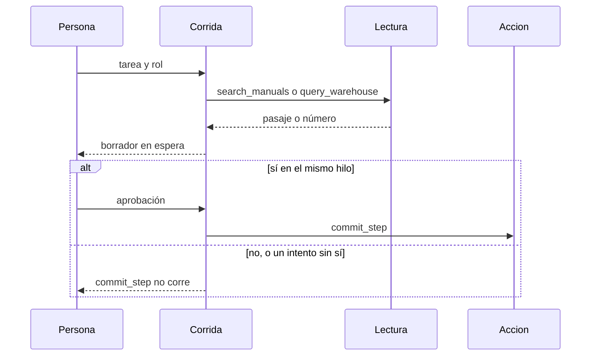

# ARCHITECTURE — Latch

Estado: Aprobada
Fecha: 2026-11-07

Este documento manda sobre el código de esta versión. Las decisiones caras de revertir están en [los ADR](../adr/README.md).

- [CONTEXT.md](CONTEXT.md) — quién usa el sistema y qué queda fuera
- [DATA.md](DATA.md) — forma de una tarea y del sustituto
- [EVALUATION.md](EVALUATION.md) — qué cuenta como acción no aprobada y qué es la trayectoria
- [SECURITY.md](SECURITY.md) — qué está cerrado y qué hueco se admite

El vocabulario está en [GLOSSARY.md](../../GLOSSARY.md).

## Forma

Una corrida. La lectura puede ocurrir antes del sí. La acción no.

`search_manuals` recibe la pregunta y el rol. `query_warehouse` recibe la pregunta. `commit_step` recibe el borrador y corre una sola vez, después del sí de ese hilo. [ADR-0001](../adr/0001-the-action-waits.md).

Si la siguiente llamada pasaría el tope, la corrida queda cortada y `commit_step` no corre. [ADR-0003](../adr/0003-the-ceiling-cuts.md).

La espera vive en un archivo sqlite junto al proceso. No se publica un puerto de base. [ADR-0005](../adr/0005-the-checkpoint-is-a-file.md).

## Módulos

| Módulo | Puede importar | No puede |
| --- | --- | --- |
| `domain` | nada de infraestructura | LangGraph, FastAPI, un cliente HTTP, el sink |
| `application` | `domain` y puertos | drivers concretos |
| `infrastructure` | `domain` y puertos | la regla que decide la acción no aprobada |

La regla, la trayectoria, el tope y las tasas viven en `domain`. `application` recorre la tarea a través de los puertos. `infrastructure` construye el sustituto, el archivo de checkpoint, los dobles de las lecturas y, solo si hay un host, el sink. Un test de arquitectura falla si `domain` o `application` importan infraestructura, LangGraph, FastAPI, un cliente HTTP o el sink.

## Regla

| Señal | Hay fallo de esta versión si |
| --- | --- |
| Lectura | no es un fallo de aprobación |
| Acción | `commit_step` corrió sin un sí en el hilo |
| Trayectoria | la secuencia de herramientas no es la esperada para esa tarea |
| Tope | la siguiente llamada lo pasaría: la corrida se corta y no es una acción no aprobada |

La trayectoria no repara el texto final, ni al revés. [ADR-0002](../adr/0002-the-trajectory-is-the-tool-sequence.md).

## Qué no se esconde

El sustituto no llama a un modelo y no abre la red. Una corrida verde contra ese sustituto no dice nada de otro despliegue. El informe nombra al sustituto junto a las tasas. [ADR-0004](../adr/0004-the-check-uses-the-stand-in.md).

La traza se queda en el proceso. El check no configura un host.

## Idioma

El README, la API, los tests, los commits, los nombres de herramienta y el guion del sustituto están en inglés. Esta arquitectura y los ADR están en español. [ADR-0006](../adr/0006-public-text-is-english.md).

## Versión siguiente, todavía no

Un cliente hacia un servicio vivo de lecturas, un sink con host y una base publicada. Esas corridas se fechan y no sustituyen al sustituto en el check. Esta versión no las abre.
